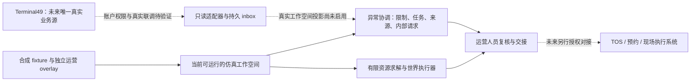

# Gate Triage 与成熟港口软件的能力比较

核验日期：**2026 年 10 月 17 日，洛杉矶时间**。比较对象为公开官方资料与本仓库当前实现；未登录竞争产品的商业账户，未取得其内部算法、客户合同、完整配置或生产运行数据。本文不构成竞品性能测试。

**结论：Gate Triage 适合定位为“可解释的异常协调与中断演练工作台”。目前最能证明的价值，是把一条线索推进为有责任方、证据和状态的工作，并在同一合成环境中检验安排是否可执行。不能声称它比 Terminal49、Port Optimizer、N4 或 TERMPoint 更懂真实港口、更快、更安全，或已经提高洛杉矶港吞吐量。**

## 1. 比较方法与证据等级

| 标记 | 本文含义 | 能支持什么 | 不能支持什么 |
|---|---|---|---|
| 官方公开能力 | 产品方或标准组织的公开文档明确写出 | 某项能力被其公开提供或描述 | 当前客户部署都具备、效果一定达标 |
| 供应商效果主张 | 官网新闻、产品宣传或客户案例中的结果 | 供应商在特定背景下作出了该主张 | 独立验证、跨码头直接推广、与我们同条件对比 |
| 本地已实现 | 对应代码、测试与交互流程存在 | 本仓库具备该项原型行为 | 已接入真实港口、达到生产 SLA |
| 本地已测量 | 有保存的运行参数、逐种子记录和结果 | 指定合成模型下的观察结果 | 真实码头收益，或优于其他商业系统 |
| 未验证 | 缺少访问权限、文档细节或实测 | 明确需要下一步取证 | 将“没公开”写成“对方没有” |

只使用第一方产品文档、官方新闻与标准组织资料描述行业产品。能力对照属于需求分析，不把产品列表当评测排名；公开材料中没有找到的功能，一律记录为“本次未验证”，不写成缺失。

## 2. 成熟方案已经解决了什么

### 2.1 Terminal49：跨来源可见性与运输异常跟踪

Terminal49 的公开风险列表已经按 LFD、扣留、费用和可提状态识别需关注的货柜，也支持检索和筛选。因此，“汇总货柜状态”“把快到期的柜子排出来”“给 hold 贴标签”都是现成能力，不应作为本项目首创。[官方 Containers At Risk，2025-04-29 更新](https://help.terminal49.com/articles/1980719496-containers-at-risk)

API 可返回货柜及相关运输事件，包含 availability、holds、fees、LFD 等字段；字段是否存在及含义受码头、船公司、旅程与里程碑影响。其 coverage 文档把重量列为船公司依赖字段，不能据此认定拿到了独立地磅读数；设备类型为 reefer 也不等于收到了温度传感器数据。[Container API](https://terminal49.com/docs/api-docs/api-reference/containers/get-a-container)、[字段覆盖](https://terminal49.com/docs/coverage/fields)

Terminal49 官方 AI/MCP 页面现已展示以自然语言查询扣留、到期和 ETA，并解释不同字段使用船公司、AIS 或码头来源的例子。因此，“在聊天里问柜子为什么没走”和“解释来源”本身也不足以构成独特优势；该页面展示的功能和案例不是我们对其商业账户的实测。[官方 AI/MCP 产品页](https://terminal49.com/ai)

**我们的关系**：Terminal49 是计划接入的上游业务数据来源。当前运行使用合成的 Terminal49 结构 fixture；真实账户字段覆盖、额度和端到端同步尚未完成验证。我们应承接其状态信息，形成内部协调任务；不重复建设全球船公司和码头采集网络。

### 2.2 Port Optimizer：港口生态的数据平台与协同入口

洛杉矶港说明 Port Optimizer 由港方与 Wabtec 于 2017 年推出，用于港口生态的信息整合和运营协同。港方现有运营页面已列出货柜跟踪、堆存、卡车周转、空柜返还及预约相关入口。不能说“洛杉矶港没有统一数据平台，所以我们来造一个”。[洛杉矶港 Port Optimizer 介绍](https://portoflosangeles.org/business/supply-chain/port-optimizer%E2%84%A2)、[港方 Cargo Operations Dashboard](https://portoflosangeles.org/business/operations)

Wabtec 的公开说明包括多方数据整合、API、访问控制、预测和延迟识别，并描述了不同参与方的视图。其“单一事实视图”属于产品定位；我们没有审计其冲突消解过程、异常工单全貌或内部求解器。[Wabtec 官方能力说明](https://www.wabteccorp.com/digital-intelligence/transportation-management/port-optimizer)

**我们借鉴的成熟做法**：紧凑导航、明确操作范围、状态标签、可筛选的主表、列偏好、选择多行、内部请求和详情抽屉。这些工作台交互属于成熟设计模式，不能因为重新做了一遍便称为创新。

**我们的关系**：当前不接入 Port Optimizer，也没有取得它的真实数据或用户权限。当前地图采用真实港口底图和公开码头参考点；可计算的运营状态仍只覆盖一个合成码头的 East/West 门区、堆场、冷藏和简化水侧作业。其他码头只作参考，状态为未知；它不是洛杉矶港总调度系统，也不是实际码头布局的复刻。

### 2.3 Kaleris N4：码头内部的计划、资源安排与执行

N4 的公开能力已经包括堆场规则、场内运输路线与派工、船舶积载、场桥优化以及控制室视图。需要安排设备和作业时，成熟 TOS 的覆盖比我们的原型广得多；“有限资源调度”不是未被行业解决的问题。[Kaleris N4 官方产品页](https://kaleris.com/solutions/terminal-operating-system/container-terminals/)

还需更新对“AI 调度创新”的判断：Kaleris 在 **2026 年 5 月 12 日**发布 Yard Intelligence Suite，公开描述了提前发现拥堵、评估备选情景、展示决策逻辑以及以自然语言表达堆场策略。这些是供应商公布的能力，尚未由本项目独立实测，但足以说明“what-if＋解释＋自然语言”不能笼统宣称为行业首次。[官方 Yard Intelligence Suite 发布](https://kaleris.com/news/kaleris-launches-yard-intelligence-suite-to-overcome-rising-capacity-constraints-unlock-value-from-existing-systems-and-support-workforce-evolution/)

**我们的关系**：N4 代表当前未覆盖的现场执行层。Gate Triage 的仿真不会产生真实吊机、拖车或闸口命令；未来若进入现场，必须经运营方授权与其执行系统对接，不能把本地求解结果直接当作设备指令。

### 2.4 APM TERMPoint：有权限边界的真实预约流程

APM 的官方 API 页面列出可用时段查询、预约创建、更新、取消和部分合并功能，Los Angeles 在其覆盖名单中，终端用户需具备 TERMPoint 授权。APM 的洛杉矶 FAQ 还提供不可定位货柜的 Trouble Resolution 渠道。这说明“预约管理”和“异常联系岗位”早已有实际运营流程，不是从一个 AI 分数才开始存在。[TERMPoint Truck Appointments API](https://developer.apmterminals.com/index.php/api/8)、[APM Los Angeles FAQ](https://akamai.apmterminals.com/en/los-angeles/practical-information/faq)

**我们的关系**：当前内部 coordination request 只写本系统数据库，不创建 TERMPoint 预约、不发邮件，也不代表 APM 或海关接收了任务。只有在未来明确改变“唯一外部业务源为 Terminal49”的限制并取得权限后，才讨论对接这类外部交易 API。

### 2.5 DCSA：共同的事件语言，不是调度产品

DCSA 的 Track & Trace 是数据交换标准。**2026 年 9 月 30 日**公布的 3.0.0 已增加 IoT 与 reefer 事件，并改进更正和撤回事件的表达；其公告说明初期面向成员与 DCSA+ 合作方，计划在 2027 年下半年公开。此前只介绍 2.2 并将温度标准视为不存在，已经不够准确。[DCSA 3.0.0 官方公告](https://dcsa.org/newsroom/track-and-trace-3-0-0-iot-reefer-visibility)、[Track & Trace 标准说明](https://dcsa.org/standards/track-and-trace)

**必须区分三件事**：标准定义了温度事件；某提供方实现并销售该数据；我们的账户实际收到了该柜的数据。这三者不能相互替代。DCSA 的更新不改变本项目当前 Terminal49 字段边界，也不证明本系统已通过 DCSA 一致性测试。

## 3. 按业务层对照，而不是排“谁最强”

| 问题 | 成熟方案的公开定位 | Gate Triage 当前实际实现 | 判断 |
|---|---|---|---|
| 跨船公司、码头获取可提、扣留、LFD | Terminal49 提供采集整合与 API | 合成 fixture；已有只读适配器和验签 inbox，尚未真实联调 | 上游能力宜集成，不应自称替代 |
| 多方了解港口货流和预测 | Port Optimizer 提供生态级可见性和协同 | 单个合成码头工作空间 | 范围不同，没有对港口平台的性能优势证据 |
| 吊机、拖车、场位、船舶等作业 | N4/TOS 提供计划、优化与执行能力 | 有限类型的模拟资源、作业先后与时间占用 | 原型明显缺少真实作业细节 |
| 给卡车预约一个真实时段 | TERMPoint 提供有权限的交易流程 | 只有内部协调请求与模拟先决条件 | 内部请求不等于预约成功 |
| 交换一致的运输与设备事件 | DCSA 定义事件与接口标准 | 借鉴事件与来源表达，未做完整标准认证 | 标准应遵循，不能当竞品击败 |
| 一个柜同时有多项限制，下一步找谁 | 公开产品已有风险和异常能力，完整内部流程未验证 | 展示独立 issue、并行 task、证据、责任角色、请求状态 | 可展示我们具体完成的工作流，不能断言别人做不到 |
| 复盘部分封路时哪些工作继续 | N4/相关高级产品公开有情景与优化能力 | 可复现的历史事件启发仿真，局部范围与恢复分段 | 可比较自有策略；不能宣布比商业系统恢复快 |
| 看清一项处理为什么没有解除另一限制 | 商业产品的客户配置与权限实现未审计 | 正常温度只改变 reefer issue，hold 与其他先决条件独立保留 | 是本产品可检验设计承诺，不是独占发明 |

上表对外部产品的依据来自第 2 节的对应官方链接；“本次未验证”不是“产品没有该能力”。

## 4. 我们真正做出了哪些可以拿出来检验的差异

### 4.1 面向这个题目的完整证据与行动链

一个合成柜被船公司结构数据标为空柜，现场 overlay 给出较重读数，同时存在升温与 customs hold。界面同时呈现几个独立问题；重量核对、冷藏检查和扣留协调可以各自推进。新增正常温度证据不会把海关状态变成放行，内部工单改为 resolved 也不会清掉来源限制。

这一点相对“只给一个风险分数、一个颜色”的简化演示更容易解释和验收。它不是对所有商业软件的否定，也不是对真实海关工作流程的替代。

对应实现：[engine.py](../gate_triage/workbench/engine.py)、[Operations.tsx](../apps/web/src/Operations.tsx)、[Panels.tsx](../apps/web/src/Panels.tsx)；观测到的浏览器与接口验收见 [验证记录](workbench-verification.md)。

### 4.2 显示“紧急响应”和“可执行交接”的区别

最需要人工关注的柜，不一定是下一辆车可提走的柜。队列排序服务于响应；departure eligibility 独立检查。计划只安排满足当前条件的最终交接，并保留其余未排任务及原因。这样可以解释为什么先处理冷藏问题，同时让其他合格柜继续走。

这相对“高分直接出闸”的错误模型更符合题意。真实许可仍属于相应机构和现场授权人；我们的执行 guard 只是合成世界中的约束。

### 4.3 用同一世界检验策略，而不是预写百分比

FIFO 和 urgency-first 也会跳过不可执行任务，采用相同资源、权限和执行检查；不是为了让优化器获胜而让基线在被扣柜前空转。按 seed 和 operation 固定服务样本；求解器只使用当前可见的到达和证据，不能提前知道未收到的恢复事件或未来实际处理时长。

本项目的测试价值是**可复查策略的取舍**，包括持平和变差。它相对单次“按一下按钮变快”的假演示更可信；与商业系统相比的优越性则没有实验依据。

对应实现：[scheduler.py](../gate_triage/workbench/scheduler.py)、[simulation.py](../gate_triage/workbench/simulation.py)。

### 4.4 隔离、可恢复的演练与内部协作

工作空间有独立访问能力、数据库状态、revision、幂等写入和作业结果；最近演练列表可恢复旧进度和请求。事故注入、延迟、重复和恢复都有合成来源标签。真实数据库解决演示进度、状态历史与重启后读取的问题，但不能据此宣传生产高可用。

对应实现：[api.py](../gate_triage/workbench/api.py)、[db.py](../gate_triage/workbench/db.py)、[worker.py](../gate_triage/workbench/worker.py)、[浏览器会话回归测试](../apps/web/tests/session-registry.test.mjs)。

## 5. 三种“更好”的说法必须分开

| 可以提出的说法 | 需要的证据 | 当前结论 |
|---|---|---|
| 比一个只排序、无权限检查的简化方案更完整 | 同一多问题柜、独立状态变化、禁止越权的测试 | 可以展示具体行为差异；不把它当成熟竞品比较 |
| 在我们的合成世界里比 FIFO 多完成交接 | 配对种子、同一事件、相同约束、完整负收益记录 | 只对有保存结果的场景和时段陈述，不保证普遍提升 |
| 比行业成熟系统吞吐更高、成本更低、响应更快 | 相同现场输入、配置、资源、负载、信息可见性与独立测量 | **没有该证据，当前不能说** |
| 用户更容易理解下一步 | 目标岗位用户的任务完成率、时间和错误率测试 | 有可操作 UI；尚无正式岗位用户对照研究 |
| 比原来更可靠 | 明确故障模型、重试、幂等、并发与重启测试 | 已验证若干本地故障与持久化行为；没有生产 SLA |
| 创造了新的行业标准或首个 AI 码头系统 | 全面先行技术检索及可辩护的技术贡献 | **不成立**；采用的是成熟数据工程、约束求解和工作台模式 |

适合比赛的原创性表述是：**“我们围绕信息冲突和局部中断，组合了一套证据可追溯、限制独立、任务可推进、策略可复查的工作流，并把这套流程做成可交互、可持久化的演练产品。”** 这是本项目的设计贡献；不声称所有组成技术由我们发明。

## 6. 实际实验怎样支撑这个产品

### 6.1 已经有确定边界的负对照

等服务控制情景中，100 个初始可执行柜、2 条车道、每柜 5 分钟、240 分钟时窗，其模型容量上界为 `2 × floor(240 / 5) = 96`。本地验证记录中，FIFO、priority、optimized 都完成 96 次有效最终交接。这里正确的结论是“三者达到相同容量界”，不是“优化器提高了吞吐”。[本地执行与浏览器验证记录](workbench-verification.md)

### 6.2 已完成的核心 30 种子结果

已读取 [核心场景汇总](../evaluation/workbench-2026-10-17/core-scenarios-summary.json)：`complete=true`、360 条检查点记录、无运行失败或世界样本配对不匹配。日常运营与 2024 事故启发场景各用 30 个种子（17–46）；每个策略世界执行 240 分钟，保存 90 与 240 分钟检查点。以下都是合成世界的均值，尚未接入任何商业产品作对照。

| 场景 / 检查点 | FIFO 完成交接 | Priority 完成交接 | CP-SAT 完成交接 | CP−FIFO 交接差及 95% 配对 bootstrap 区间 | CP−FIFO 已完成样本平均等待差 |
|---|---:|---:|---:|---|---|
| 日常 / 90 分钟 | 41.03 | 40.50 | 43.73 | +2.70，区间 [2.40, 3.00] | **+0.68 分钟，变差** |
| 事故 / 90 分钟 | 32.17 | 31.60 | 32.27 | +0.10，区间 [−0.17, 0.33] | **+1.07 分钟，变差** |
| 日常 / 240 分钟 | 50.97 | 50.97 | 51.00 | +0.03，区间 [0.00, 0.10] | −7.99 分钟 |
| 事故 / 240 分钟 | 50.97 | 50.97 | 51.00 | +0.03，区间 [0.00, 0.10] | −3.71 分钟 |

应同时说出的取舍：

- **日常 90 分钟**：30 个种子都比 FIFO 多完成 1–4 个交接，均值 +2.70；但已完成样本平均等待为 CP 10.45 对 FIFO 9.78 分钟，P90 为 24.84 对 20.56 分钟。完成更多不等于每项体验更好。
- **事故 90 分钟**：相对 FIFO，9 次更多、15 次持平、6 次更少；完成差区间跨零，不能宣传稳定吞吐提升。CP 平均等待 13.40 对 FIFO 12.33 分钟，P90 为 32.21 对 22.09 分钟，也更差。
- **240 分钟**：两个场景相对 FIFO 都是 29 个种子完成量持平、1 个多完成一个；此时突出完成量改善意义很小。已完成样本等待较少仍必须与未完成对象一起解释。
- **删失与积压**：日常 90 分钟未完成 backlog 均值为 FIFO 55.97、CP 53.27；事故为 64.83、64.73。240 分钟仍约有 46 个未完成对象；这些对象不能被等待统计悄悄删除。
- **求解与约束**：核心记录中约束违反、无效执行尝试和轨迹审计错误都为零；CP 在两个场景的 90 分钟检查点各累计 5 次回退、240 分钟各 6 次回退。回退次数是求解调用事件数，不是发生回退的种子数，也不是生产安全证明。

这支持“当前模型下可以研究吞吐与等待的取舍”，并不支持“紧急情况下始终提高吞吐”“整体等待一定下降”或“优于 N4”。完整矩阵现已完成：459 个策略世界、918 条检查点记录、12 个场景与时窗组合；汇总没有运行失败或配对不匹配，保留了 21 次经验证的 CP 回退。全量数据见 [summary.json](../evaluation/workbench-2026-10-17/summary.json)、[仿真评估报告](simulation-evaluation.zh-CN.md) 与 [原始逐运行记录](../evaluation/workbench-2026-10-17/runs.jsonl)。

### 6.3 完整矩阵的其他 90 分钟结果

| 合成情景 | FIFO / Priority / CP 平均交接 | CP−FIFO 完成差与 95% 配对 bootstrap 区间 | CP 对 FIFO 胜 / 平 / 负 | CP−FIFO 已完成平均等待差 |
|---|---|---|---|---|
| 2017 启发的数据中断 | 25.13 / 24.60 / 25.17 | +0.03，[−0.23, 0.30] | 7 / 18 / 5 | −0.24 分钟 |
| 2021 启发的长滞箱积压 | 41.47 / 41.63 / 44.73 | +3.27，[2.80, 3.70] | 29 / 1 / 0 | +0.15 分钟 |
| 2023 天气预警但不关闭 | 41.03 / 40.50 / 43.70 | +2.67，[2.33, 3.00] | 30 / 0 / 0 | +0.77 分钟 |
| 等服务负对照（3 个种子） | 36 / 36 / 36 | 0，不计算区间 | 0 / 3 / 0 | 0 |

数据中断的吞吐差异同样不能认定为稳定改进。天气预警场景没有真实关闭，接近日常结果正是必要的对照；不能把它宣传为“风暴停港后我们的算法仍创造了收益”。等服务控制 240 分钟三者都为 96。

矩阵仍以固定 fixture 和有限的随机服务模型为样本，不是洛杉矶真实港口总体。**新增地图、通用 incident workflow、简化船舶阶段的交互与集成测试，不自动成为这组 30 种子核心调度结果的一部分。** 重跑或改变引擎时必须比对 metadata 代码与数据摘要，不把新旧模型结果混为同一次实验。

### 6.4 多种子结果的使用规则

读取完整报告时应同时报告：

1. 场景、运行版本、seed 集合、时窗、政策与求解预算。
2. 实际完成交接，而非 projected schedule 的作业数；维护和复称不计最终交接。
3. 相对 FIFO、priority 的逐 seed 差异，以及提升、持平、变差各有多少次。
4. 已完成样本的平均等待、P90，以及未完成 backlog 和删失等待下界。
5. 同一组的业务收益与代价；不能只挑吞吐较高而省略等待更长。
6. 求解超时、非最优状态、回退与验证拒绝；不静默删除失败运行。
7. 若给区间，注明以种子为配对样本单位的方法；不要把同一运行内的相关货柜当独立样本。

90 分钟用于看早期处置与中断中的取舍，240 分钟用于看较长时窗与需求耗尽后的结果。所有策略最终同数可能只是可执行需求已经走完，不能反过来把吞吐平局宣传为对优化算法的全面否定。

**这些实验没有运行 Terminal49、Port Optimizer、N4 或 TERMPoint，因此不能用它们给商业产品排性能名次。**

## 7. 当前实现还缺什么

以下结论来自代码和本地验证记录，不把原技术规范中的目标自动当成已交付。

| 主题 | 当前事实 | 尚缺的实际工作 |
|---|---|---|
| 唯一外部业务源 | 当前使用合成 provider 记录与独立现场 overlay | 团队真实 Terminal49 账户、目标码头字段探测与完整数据管线联调 |
| 真实 webhook | 有 HMAC 验签、去重、冲突隔离与持久 inbox | 当前 inbox 是 stored-unprojected；未把真实事件投影到匿名 live 工作空间 |
| 字段与新鲜度 | 模拟 feed 有延迟、重复、字段顺序与恢复检查 | 无法从演示结果断言供应方真实延迟、缺失率或全部事件语义已经验证 |
| 现场几何与作业 | 有有限资源、占用、依赖与局部门区 | 无真实堆场位置、翻箱、设备行走、交通避让、班次工种、船舶积载或危险货物现场规程 |
| 求解器 | OR-Tools CP-SAT；当前 60 分钟滚动规划；单求解器线程、有限墙钟预算、独立验证 | 没有生产规模基准、实时设备联调或全局最优服务保证 |
| 多方利益 | 奖励包括交接、紧急检查、等待与优先级，并展示服务组结果 | 没有合同级公平配额、严格最长等待约束、谈判机制或真正的多方收益模型 |
| 政策配置 | 有 throughput / balanced / recovery 几个已知 profile | 当前是透明加权目标，不能称为完整字典序优化或自动理解未知政策 |
| 物理执行 | 合成世界会二次核验；中断作业可能重新开始 | 真实作业中止、续作、危险品处置与机械控制完全不在原型执行范围 |
| 应急恢复 | 有局部关闭、减容和阶段恢复事件 | 未配置独立正常服务恢复目标，因此恢复时间 KPI 仍为 not_identifiable |
| 访问控制 | 浏览器能力 token，工作空间隔离 | 未做完整组织账户、岗位 RBAC、跨设备恢复、企业身份和生产密钥管理 |
| Worker | SQL 持久队列、lease、重试；本地应用线程执行 | 未做多副本高可用压力验证；重启后播放暂停，需明确恢复 |
| RAG / 大模型 | 本地 BM25 检索可检查的人工整理条目和来源链接，界面标 No LLM | 没有生成式回答、embedding 模型、自动更新知识库或完整 RAG 评测 |
| 行业标准 | 借鉴来源、事件时钟、状态和约束分层 | 无 DCSA 全量一致性证明；没有适用全部码头的统一 SOP 认证 |
| 产品有效性 | 有自动化测试与实际浏览器操作记录 | 无码头岗位正式试用、真实交接闭环、生产效果或与商业平台的同条件对照 |

求解器目前依据可见状态分配资源，不是 GRPO 或强化学习；profile 中的等待奖励也不等于已经解决了所有 stakeholder 的公平问题。将来加大模型，不能掩盖这些模型边界。

## 8. 实时数据、检索与求解分别负责什么

| 层 | 正确职责 | 当前对应实现 | 不应承担的职责 |
|---|---|---|---|
| 事件接收 | 接受新状态、保留观察/接收时间、去重与顺序 | 合成 feed；真实 webhook inbox 边界 | 用历史网页推断“现在道路已关闭” |
| 事实与约束 | 保留并行限制，确定动作是否可执行 | 状态投影、issue、eligibility、验证器 | 因一项任务完成而默认清除所有 hold |
| 约束优化 | 在允许动作中分配资源和时间，说明未安排原因 | CP-SAT、滚动重排与统一执行 guard | 凭优化收益获得海关或码头权限 |
| 内部协作 | 指明角色、事项、证据缺口与进展 | Coordination requests 与 task 状态 | 冒充已通知外部人员或已完成真实预约 |
| 来源检索 | 帮人阅读相关规则和历史背景 | 本地 BM25 条目、原始来源 URL、No LLM 标记 | 将相关段落视为当前现场事实 |
| 未来生成式解释 | 根据固定事实和合法动作草拟可引用交接摘要 | 未来可选，当前未启用 | 自动写回许可、篡改阈值或控制现场设备 |

Terminal49 的官方 webhook 文档要求验签、处理重复投递并在必要时补取缺失状态。这是应采用的成熟可靠性做法，不是我们发明的通信协议；浏览器 SSE 只是本应用向页面传递 revision 更新，不能称为真实传感器连续流。[官方 webhook 指南](https://terminal49.com/docs/api-docs/in-depth-guides/webhooks)

## 9. Buy / Build / Integrate：怎样放进真实技术栈

| 如果你需要 | 合理路径 | Gate Triage 的位置 |
|---|---|---|
| 多船公司、多码头的运输跟踪 | 使用成熟可见性供应方，逐字段验证覆盖与账户权限 | 接 Terminal49，不自行维护全球采集 |
| 洛杉矶港公共运营信息和港口协同 | 了解港方已有 Port Optimizer 与运营入口 | 当前作为行业背景参考，不作为第二个运行时业务源 |
| 真实卡车预约和终端交易 | 使用运营方授权的系统与交易 API | 当前内部请求只做工作管理；外部写入需另立项目授权 |
| 真实场内设备计划与执行 | 与运营方 TOS/ECS 及现场安全流程协同 | 当前仿真结果作为候选建议，不连接执行设备 |
| 面向本地异常的解释与协作体验 | 在已知上游状态上构建任务、来源和人工复核工作流 | 本项目可探索的定制层 |
| 用于训练、对比和回归的中断演练 | 构建独立合成世界，并对照实际测量做校准 | 本项目已经可运行的实验与演练层 |

当前产品应保持这个部署逻辑：

图是本项目的设计定位，不是洛杉矶港现有内部架构；虚线表示当前未接通的真实数据或执行路径。PostgreSQL、求解器和离线知识库不是第二个外部业务数据提供方。真实账户读取还受 Terminal49 的 entitlement 约束，应检查当前权限，不能假设免费 key 能读取本演示全部 100 个柜。[官方账户权限说明](https://terminal49.com/docs/api-docs/useful-info/entitlements)

## 10. 可以直接用于讲解的表述

**项目介绍**：我们做的是一个港口异常协调与中断演练工作台。它把同一货柜的多条证据、独立限制和并行待办放到一起，再在有明确合成资源的场景中比较可执行安排。

**与 Terminal49 的关系**：Terminal49 解决可见性与上游数据整合，我们探索的是这些状态进入运营人员工作台之后，如何形成可追踪的下一步。当前演示没有真实账户数据；温度、重量和资源来自单独标记的模拟层。

**与成熟平台的关系**：现有平台已经有跟踪、风险、预约和优化能力。我们的贡献不是再宣布一次“AI 能调度”，而是交付一个范围清楚、可以操作、能复查证据与策略取舍的原型。

**效率证据**：我们展示同一合成世界中的配对比较，也公开持平与变差。任何提升只描述对应的场景、时窗和指标，不宣称提高了真实洛杉矶港吞吐量。

**Dual-use**：日常用同一套证据与任务模型处理可提准备和异常；中断时只改变受影响范围、容量和信息条件，观察哪些工作可以继续、哪些必须等待。恢复效果通过合成轨迹研究，不以虚构货损或固定节省金额支撑。

## 11. 官方来源与核验记录

下列页面均于 **2026-10-17**读取。无明确页面发布日期时记为“未标明”，不使用搜索引擎抓取时间代替发布日期。本文未复制长段原文；供应商效果主张均按其自述处理。

| 编号 | 发布者 / 页面 | 页面日期或版本 | 本文使用范围 |
|---|---|---|---|
| S01 | [Terminal49：Containers At Risk](https://help.terminal49.com/articles/1980719496-containers-at-risk) | 更新 2025-04-29 | 风险列表、LFD、holds/fees、筛选 |
| S02 | [Terminal49：Get a container](https://terminal49.com/docs/api-docs/api-reference/containers/get-a-container) | 动态 API 文档，未标明发布日 | 货柜资源字段及关系；不代表本账户数据可得 |
| S03 | [Terminal49：Field availability](https://terminal49.com/docs/coverage/fields) | 动态 coverage 文档，未标明发布日 | 字段来源与依赖；重量不等于独立地磅 |
| S04 | [Terminal49：AI / MCP](https://terminal49.com/ai) | 未标明；本次可读官方搜索快照 | 自然语言查询、来源解释的公开产品展示；非账户实测 |
| S05 | [Terminal49：Set up webhooks](https://terminal49.com/docs/api-docs/in-depth-guides/webhooks) | 动态 API 文档，未标明发布日 | 签名、重复投递、补取；真实管线仍需联调 |
| S06 | [Terminal49：Entitlements and Paid Features](https://terminal49.com/docs/api-docs/useful-info/entitlements) | 动态账户权限文档，未标明发布日 | 读取与附加功能受账户权限限制 |
| S07 | [洛杉矶港：Port Optimizer](https://portoflosangeles.org/business/supply-chain/port-optimizer%E2%84%A2) | 页面未标明；内容记述 2017 年启动 | 港口已有数字信息平台，不能描述为行业空白 |
| S08 | [洛杉矶港：Cargo Operations Dashboard](https://portoflosangeles.org/business/operations) | 持续更新运营页面 | 港方现有运营数据与工具入口 |
| S09 | [Wabtec：Port Optimizer](https://www.wabteccorp.com/digital-intelligence/transportation-management/port-optimizer) | 页面未标明发布日期 | 官方产品范围与参与方视图；不是算法审计 |
| S10 | [Kaleris：N4 / Container Terminals](https://kaleris.com/solutions/terminal-operating-system/container-terminals/) | 页面未标明发布日期 | 堆场、运输、船舶、设备与控制室能力 |
| S11 | [Kaleris：Yard Intelligence Suite 发布](https://kaleris.com/news/kaleris-launches-yard-intelligence-suite-to-overcome-rising-capacity-constraints-unlock-value-from-existing-systems-and-support-workforce-evolution/) | 2026-05-12 | 情景评估、解释与自然语言策略的供应商公开主张 |
| S12 | [APM：TERMPoint Truck Appointments API](https://developer.apmterminals.com/index.php/api/8) | 动态 API 页面；所列 API 1.0 | 授权预约操作与目标码头覆盖 |
| S13 | [APM：Los Angeles FAQ](https://akamai.apmterminals.com/en/los-angeles/practical-information/faq) | 未标明；运行规则可变化 | 预约与 Trouble Resolution 已有实际流程；不推广成全港统一 SOP |
| S14 | [DCSA：T&T 3.0.0 发布](https://dcsa.org/newsroom/track-and-trace-3-0-0-iot-reefer-visibility) | 2026-09-30，3.0.0 | IoT/reefer、更正事件与初期访问范围 |
| S15 | [DCSA：Track & Trace](https://dcsa.org/standards/track-and-trace) | 当前标准概览 | 数据交换标准的定位；不是本项目合规认证 |

## 12. 后续验证与更新

引入真实账户前，先对选定柜核验 coverage、null/缺失语义、时区、Terminal49 刷新和通知行为，并保存脱敏合同测试。引入真实现场动作前，由目标码头运营方核对允许动作、责任岗位、审批链和接口授权。要做“比行业更好”的主张，则需要与授权参照系统在同一场地、输入、资源和指标下做受控对比；公开官网材料和本地种子实验都不能替代这个步骤。

当模型、数据或场景政策改变后，应生成独立版本的评估目录，保留现有持平、变差和回退记录，不修改其“无商业产品 head-to-head”的结论。
