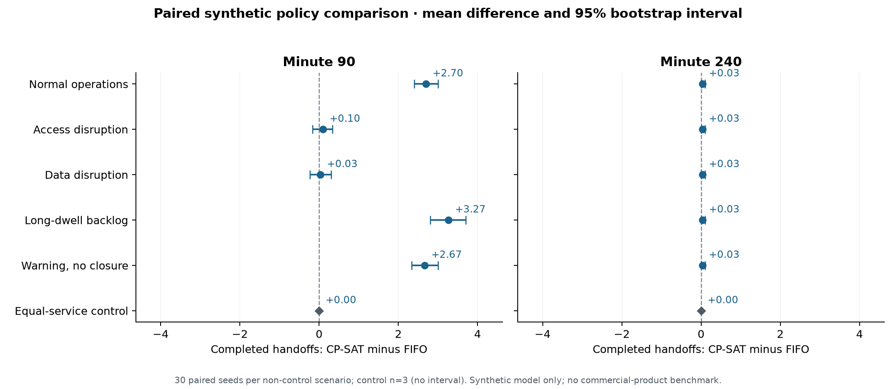

# Gate Triage 仿真实验与成熟方法对照

完整预定矩阵已运行并通过独立数据检查：459 个策略世界、918 个 90/240 分钟检查点。全部结果、失败检查和来源信息见 [summary.json](../evaluation/workbench-2026-10-17/summary.json)、[runs.jsonl](../evaluation/workbench-2026-10-17/runs.jsonl)、[metadata.json](../evaluation/workbench-2026-10-17/metadata.json) 及 [validation.json](../evaluation/workbench-2026-10-17/validation.json)。

## 实验回答什么

比较同一个合成运营世界中的三种内部策略：先到先服务（FIFO）、紧急度排序（priority）、约束优化（OR-Tools CP-SAT）。三者使用相同数据、信息到达时间、许可条件、资源容量、依赖关系和执行检查；基线会跳过不可执行任务，也采用相同的工作保持调度，不故意让基线空转。

这里没有安装或测试商业 TOS、Terminal49、Port Optimizer 等产品。实验不能证明我们比这些产品更快、更省钱或更安全。成熟产品比较的范围应是公开功能与我们的集成位置；本报告只提供内部方法基线的真实合成运行结果。

## 固定设计

- 五个非控制场景分别运行 30 个配对种子（17–46）；等服务控制场景运行 3 个种子（17–19）。控制使用固定五分钟服务时长，三个种子保留容量校验，避免额外 27 次重复的确定性控制。
- 每个策略世界执行到第 240 分钟，同时保存第 90 和 240 分钟检查点。复用同一轨迹避免重复运行；第 90 分钟不被当作关闭运营的时刻，规划模型的总时限仍为 240 分钟。
- 每个场景含 100 条合成货柜记录。供应方形状数据与现场运营覆盖层保持分开；已在来源中报告离开的历史旅程不重新加入本轮到达，不计作本轮完成。
- 每个工作资源、作业时长、道路范围、信息延迟和恢复时间均为模拟设定。历史事件只解释演练背景，没有历史逐柜重建或实际收益主张。
- 每个 CP-SAT 求解使用一个线程、最多 0.08 秒墙钟预算。运行两个独立进程以完成整个矩阵，记录并保留求解状态、回退及耗时。世界样本固定，但受墙钟预算和 CPU 竞争影响，求解结果可能变化。
- 规划只使用当时已经观察的到达和来源信息。离线审计器事后可以读取实际资源日历来检查已发生的执行；这不把未来事件提供给调度策略。

## 指标与分母

| 指标 | 本次含义 | 解释限制 |
|---|---|---|
| 实际模拟完成交接 | 执行器确认的最终 gate handoff，每个旅程最多一次 | 核查、维护、联系和计划中的动作不计吞吐量 |
| 平均与 P90 等待 | 已完成对象，从模拟车辆到达到 gate 服务开始 | 是完成样本分布，必须同时看未完成积压，不能把截尾对象删掉后宣称整体等待改善 |
| 未完成等待下界 | 未完成且已经到达对象，截至检查点的等待；报告均值与最大值 | 这些对象的最终等待尚未知，不能混入完成样本作为完整观察 |
| 服务组等待差距 | 各匿名运输组平均等待的最大值减最小值，包含未完成与阻塞对象的截至观察等待 | 是描述指标，不是合格队列的严格公平保证；也不证明每一组结果相同 |
| 约束与执行检查 | 资源容量、兼容资源、共同资源、先后依赖、重复完成、执行器拒绝与计划验证 | 实际轨迹独立审计资源和依赖；权限仍由公共执行器守卫及回归测试保护，不声称完整生产安全认证 |
| 耗时与回退 | 每次运行墙钟时间、累计求解时间、状态和回退次数 | 本机、当前并发与求解预算的测量，不能外推生产延迟 SLA |

每个原始检查点保留服务组的到达数、完成数、均值和最大等待；不只展示等待最少的组。所有运行失败、配对样本不匹配、负收益和持平结果都保留。

## 配对与不确定性

每个策略组合必须具有相同的 `world_sample_hash`，该摘要覆盖同种子作业时长、到达样本及场景配置。脚本显式检查配对，任何不匹配均列为失败，不静默丢弃。

均值差为“优化策略减去基线”。完成数差为正通常表示完成更多；等待与积压差为负通常表示更少。但等待比较须联同完成样本数和未完成下界阅读。

对 30 个配对种子的差值进行 10,000 次固定随机种子的成对 bootstrap，报告均值差的 2.5%–97.5% 百分位区间。抽样单位是运行种子，不把同一个队列里的货柜当作相互独立的重复实验。只有 3 个确定性控制种子时不计算置信区间。区间是描述性的，未对多场景、多指标比较调整；固定 fixture 和有限随机模型也不是真实港口总体样本。

## 独立检查与已知边界

离线实际轨迹审计检查每分钟资源容量、兼容资源、共同资源、先后依赖、重复 handoff 及完成计数。等服务控制的理论容量为两条车道 × `floor(240/5)`，上限为 96 次交接；90 分钟上限为 36 次。三个不空转策略应达到相同完成数。

当前优化使用可检查的加权目标，非分层最优或硬性最长等待保障。当前运行中作业占用受保护，未开始计划没有固定五分钟冻结承诺。恢复时间在缺少预先配置的正常服务参考目标时不输出猜测数字。费用更新保留来源但本矩阵不将费用转换成“已实现节省”。

## 重现

```bash
.venv/bin/python scripts/benchmark_workbench.py --workers 2
```

完整命令和版本信息见 metadata。脚本把每个世界的结果立即追加到 JSONL，并定期保存汇总；相同代码和 fixture 下可以继续未完成的目录。代码或 fixture 摘要改变时拒绝混合结果，应选择新的输出目录。


## 完整矩阵结果

下面按预定的全部场景与两个观察窗口列出结果，没有挑选获胜场景。单位为每次合成运行完成的最终交接数，FIFO / Priority / CP 分别为先到先服务、紧急度和约束优化。区间为 CP−FIFO 配对均值差的 95% bootstrap 百分位区间。

| 场景 | 分钟 | 每策略种子数 | FIFO | Priority | CP | CP−FIFO〔95%区间〕 | CP 相对 FIFO 赢 / 平 / 输 |
|---|---:|---:|---:|---:|---:|---|---|
| 日常运营 | 90 | 30 | 41.03 | 40.50 | 43.73 | 2.70〔2.40, 3.00〕 | 30 / 0 / 0 |
| 日常运营 | 240 | 30 | 50.97 | 50.97 | 51.00 | 0.03〔0.00, 0.10〕 | 1 / 29 / 0 |
| 局部道路中断 | 90 | 30 | 32.17 | 31.60 | 32.27 | 0.10〔-0.17, 0.33〕 | 9 / 15 / 6 |
| 局部道路中断 | 240 | 30 | 50.97 | 50.97 | 51.00 | 0.03〔0.00, 0.10〕 | 1 / 29 / 0 |
| 数据与运营中断 | 90 | 30 | 25.13 | 24.60 | 25.17 | 0.03〔-0.23, 0.30〕 | 7 / 18 / 5 |
| 数据与运营中断 | 240 | 30 | 50.97 | 50.97 | 51.00 | 0.03〔0.00, 0.10〕 | 1 / 29 / 0 |
| 长滞箱拥堵 | 90 | 30 | 41.47 | 41.63 | 44.73 | 3.27〔2.80, 3.70〕 | 29 / 1 / 0 |
| 长滞箱拥堵 | 240 | 30 | 50.97 | 50.97 | 51.00 | 0.03〔0.00, 0.10〕 | 1 / 29 / 0 |
| 天气预警对照 | 90 | 30 | 41.03 | 40.50 | 43.70 | 2.67〔2.33, 3.00〕 | 30 / 0 / 0 |
| 天气预警对照 | 240 | 30 | 50.97 | 50.97 | 51.00 | 0.03〔0.00, 0.10〕 | 1 / 29 / 0 |
| 等服务控制 | 90 | 3 | 36.00 | 36.00 | 36.00 | 0.00〔n=3，不计算区间〕 | 0 / 3 / 0 |
| 等服务控制 | 240 | 3 | 96.00 | 96.00 | 96.00 | 0.00〔n=3，不计算区间〕 | 0 / 3 / 0 |



图中零线表示持平；同一横轴比例用于两个观察窗口。控制场景只有 3 个确定性种子，不绘制置信区间。

## 等待、积压与服务组取舍

等待值是每次运行统计值的跨运行均值：因此表中‘P90均值’并非把所有货柜混在一起重新求一个 P90。组间差距包含阻塞与未完成对象，不能解释为硬性公平承诺。

| 场景 / 分钟 | 平均等待 FIFO / Priority / CP | P90 等待均值 FIFO / Priority / CP | 未完成积压 FIFO / Priority / CP | 组间均值差距 FIFO / Priority / CP |
|---|---|---|---|---|
| 日常运营 / 90 | 9.78 / 11.15 / 10.45 | 20.56 / 32.73 / 24.84 | 55.97 / 56.50 / 53.27 | 11.45 / 11.07 / 11.30 |
| 日常运营 / 240 | 21.72 / 21.06 / 13.73 | 77.69 / 56.65 / 31.60 | 46.03 / 46.03 / 46.00 | 67.18 / 61.13 / 63.06 |
| 局部道路中断 / 90 | 12.33 / 13.62 / 13.40 | 22.09 / 34.79 / 32.21 | 64.83 / 65.40 / 64.73 | 7.23 / 9.85 / 9.94 |
| 局部道路中断 / 240 | 31.07 / 31.72 / 27.35 | 80.05 / 71.28 / 65.80 | 46.03 / 46.03 / 46.00 | 56.18 / 55.46 / 53.50 |
| 数据与运营中断 / 90 | 10.19 / 11.28 / 9.95 | 19.05 / 26.13 / 19.09 | 71.87 / 72.40 / 71.83 | 6.04 / 8.84 / 8.80 |
| 数据与运营中断 / 240 | 65.61 / 67.41 / 65.16 | 126.17 / 135.07 / 130.17 | 46.03 / 46.03 / 46.00 | 33.54 / 40.72 / 40.57 |
| 长滞箱拥堵 / 90 | 20.40 / 20.51 / 20.55 | 48.78 / 52.63 / 47.64 | 55.53 / 55.37 / 52.27 | 16.85 / 17.83 / 17.41 |
| 长滞箱拥堵 / 240 | 36.01 / 34.50 / 27.33 | 90.60 / 71.04 / 65.00 | 46.03 / 46.03 / 46.00 | 72.56 / 67.89 / 69.24 |
| 天气预警对照 / 90 | 9.78 / 11.15 / 10.54 | 20.56 / 32.73 / 24.80 | 55.97 / 56.50 / 53.30 | 11.45 / 11.07 / 11.25 |
| 天气预警对照 / 240 | 21.72 / 21.06 / 13.73 | 77.69 / 56.65 / 32.30 | 46.03 / 46.03 / 46.00 | 67.18 / 61.13 / 63.16 |
| 等服务控制 / 90 | 42.50 / 42.50 / 42.50 | 77.50 / 77.50 / 77.50 | 64.00 / 64.00 / 64.00 | 3.60 / 6.00 / 6.00 |
| 等服务控制 / 240 | 117.50 / 117.50 / 117.50 | 212.50 / 212.50 / 212.50 | 4.00 / 4.00 / 4.00 | 12.40 / 21.80 / 21.80 |

未完成对象的等待下界均值、最大值、每个服务组的到达 / 完成数及等待均值 / 最大值，均保存在逐运行原始记录。选择策略时应同时检查这些值；只比较完成样本等待可能受选择和截尾影响。

## 验证、运行开销与复现边界

共完成 459 个策略世界、918 个检查点；原始失败 0、配对世界摘要不匹配 0、独立实际轨迹审计错误 0。最终窗口累计计划回退 21 次、计划验证拒绝 0 次。两个检查点来自同一世界，因此求解次数及回退总数只按 240 分钟记录累计，不把前 90 分钟重复相加。

本次矩阵实际墙钟耗时 559.6 秒，两个进程并行执行。单世界运行时间与每次求解状态保留在原始记录。求解的墙钟预算会受机器负载影响；即使世界样本相同，也不保证在另一台机器或另一负载下得到相同的 CP 解。

### 各策略 240 分钟运行墙钟时间

| 策略 | 世界数 | 均值（秒） | 最大（秒） | 回退数 |
|---|---:|---:|---:|---:|
| fifo | 153 | 0.420 | 0.716 | 0 |
| priority | 153 | 0.428 | 0.755 | 0 |
| optimized | 153 | 6.200 | 9.230 | 21 |

所有场景使用同一个 throughput 配置；本矩阵没有把 balanced/recovery 配置另当作已验证的优胜策略。技术差异来自可选区间、共同资源、任务依赖、滚动观察和共同执行守卫；本实验不能把不同指标的变化归因于某一个单独机制。

### 保留的预检记录

初次预检发现第 90 分钟曲线引用了后来继续增长的列表。数值指标未受影响；修正为检查点曲线副本后，重新运行完整矩阵。预检记录及原始脚本保存在 `evaluation/workbench-preflight-2026-10-17/`，不纳入最终估计。这个排除基于预先发现的记录格式缺陷，而非运行结果好坏。

### 验收结论的范围

本结果支持‘这个合成模型中的约束调度可以运行、可以接受同条件比较，并会呈现改善、持平及取舍’，不支持‘商业系统没有这些功能’或‘真实港口一定达到相同比例增益’。是否投入真实运行仍需账号覆盖核验、现场权限与资源接入以及受控试点。

### 地图与船舶作业扩展的验证边界

以上 30 种子矩阵评估的是冻结的基线引擎版本，完整代码与 fixture 保存在 `evaluation/workbench-2026-10-17/source-snapshot/`。随后增加的地图事件层及 12 条独立合成船舶作业，不属于该矩阵的已验证调度增益。

扩展使用专用装船、卸船和航道资源，不把已卸船的 100 条跟踪旅程重新当成待卸船箱，也不把船舶作业数算作 gate handoff 或 TEU。新增回归在六个原场景、FIFO 与 Priority、90/240 分钟、种子 17 共 24 个检查点中，与冻结基线获得完全相同的交接明细和 gate 候选输入；记录见 `spatial-extension-regression.json`。这是代表性的确定性回归，不是重新运行全部 30 种子优化矩阵。新增事件重叠、人工封控、电力/来源故障独立性及航道不停止已靠泊岸桥作业另有单元测试。
